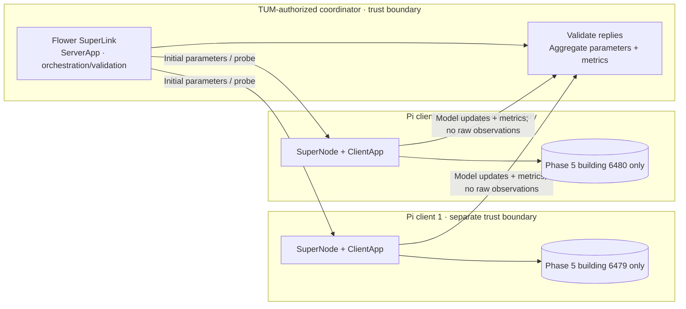

# Phase 7 — Raspberry Pi Federated Infrastructure (Steps 35–40)

Phase 7 establishes safe Raspberry Pi inventory, client allocation, software
environment checks, and a Flower communication-only smoke test. It does **not**
implement federated CNN training or FedAvg training rounds; those remain Phase 8.
No Raspberry Pi settings or TUM network services are changed by these tools.

## What is verified now

| Area | Status |
|---|---|
| Phase 5 data | All 17 real client datasets (6479–6495) load with the existing Phase 5 loader. Each has 203/59/45 train/validation/test samples; tensors are `(N, 4, 7)` and finite. |
| Local Python | The selected workspace interpreter is Python 3.12.12. |
| Local PyTorch/CNN | CPU PyTorch is installed; `deployment/verify_environment.py` verifies inference and model-state round-trip. |
| Flower | Flower 1.43.0 and NumPy installed and `pip check` passed in user-owned virtual environments on the controller, `node-52`, and `node-53`; Python versions are 3.12.3, 3.11.2, and 3.11.2 respectively. |
| Pi inventory | **4 worker Pis inspected** using read-only commands run through the authorized controller: `node-52` through `node-55`. All four reports identify Raspberry Pi 5 Model B Rev 1.0, aarch64/Cortex-A76, 4 cores, Debian 12, Python 3.11.2, 7.9 GiB RAM, and 119.1 GB MMC storage. Controller inventory: Ubuntu Linux, aarch64, Python 3.12.3, 104 GB available on `/`. The supplied cluster inventory lists 44 worker IDs; only these four selected/candidate Pis were inspected. The other 40 were not assessed, rather than determined to be inaccessible. |
| Network / test security | `node-52` and `node-53` reached the controller at `192.168.50.1:22`. Flower ran on port 8000 with TLS and SuperNode authentication enabled. A temporary 14-day test CA/server certificate and distinct Flower ECDSA P-384 client keys were used; certificate verification succeeded and CA copies matched. This was a temporary test PKI, not a cluster-provisioned CA. |
| Physical Flower run | **PASSED, one round.** The controller received responses from two authenticated physical SuperNodes. `node-52` ID `4158088495255200623` and `node-53` ID `2126198045130776827` returned the expected aggregate `[5.0, 5.0]`, 4 examples, and weighted loss `7.0`. Synthetic parameters only; no training or real data access. Both Pis reported no Flower processes after the test, and controller port 8000 was released. |
| Pi CNN runtime | **PASSED on both initial clients.** `deployment/verify_pi_cnn.py` ran on `node-52` and `node-53`: Python 3.11.2/aarch64, PyTorch 2.15.0+cu132, CPU inference output `(2, 1)`, and six-array model-parameter round-trip passed. CUDA was unavailable, as expected. |
| Mapping validation | 2- and 4-client mappings passed with every mapped host inventory-verified; 8- and 17-client logical/data mappings passed, but include unverified Pi candidates. |
| Automated tests | Full repository suite: **50 passed, 51 subtests passed**. |

**Completion boundary:** Steps 35–40 are implemented and validated for the
initial two-client physical deployment. This is not a claim that a 17–18-Pi
deployment is complete: only four Pis were inventoried, and only two completed
the physical Flower and CNN checks. Larger rollout requires inventory and
staged physical validation of each additional device. Phase 8 training is also
out of scope.

The uploaded cluster README includes private connection and credential details.
They are intentionally not copied into FEDEMS configuration, code, tests, or
this report. Rotate any credentials that may still be active and do not use
documented bootstrap credentials for research deployment.

## Step 35 — Read-only hardware inventory

`deployment/inventory.py` connects only to SSH aliases explicitly listed in
`configs/raspberry-pi-hosts.local.json`. It uses OpenSSH, honors the user's
`~/.ssh/config` (ports, identity selection, and jump hosts), enforces
`StrictHostKeyChecking=yes` and `BatchMode=yes`, and executes a read-only
Python inventory script. The host allowlist rejects passwords and other
credential fields. Unreachable hosts are recorded without aborting the rest.

The inventory reports were collected in the authorized Remote-SSH controller
session; read-only SSH collection from that controller succeeded for
`node-52` through `node-55`. `node-52` and `node-53` can also reach the
controller's `192.168.50.1` Ethernet address on SSH port 22. This is not
evidence that the local Windows workspace can authenticate directly, nor does
it prove Flower application communication. The controller's reported
architecture, Python, and home filesystem were inspected separately.
The supplied cluster inventory lists 44 worker IDs; this runbook records the
four selected/candidate Pis actually inspected and makes no claim about the
remaining 40.

To configure a local inventory, copy the empty example and add only verified,
authorized OpenSSH aliases:

```powershell
Copy-Item configs\raspberry-pi-hosts.example.json configs\raspberry-pi-hosts.local.json
# Edit the ignored local file; keep users, keys, IPs, and secrets in SSH config.
python -m deployment.inventory
```

An entry can specify `device_id`, `ssh_alias`, `role`, and optional `port` and
`jump_host_alias`. The alias must already have a trusted host key. OpenSSH
credentials and host-key verification remain under the user's control. Do not
add a range, discover hosts, or populate an allowlist from guessed addresses.

The default JSON/CSV outputs are under ignored `results/phase7/`. Add
`--sanitize` before sharing a report; it removes SSH aliases, hostnames, IP
addresses, and connection-specific error text. Summaries must report only the
devices actually inspected. The four user-collected reports are evidence of
hardware inventory only; they do not prove software readiness or Flower
connectivity.

**Initial hardware candidates:** `node-52` and `node-53` are suitable initial
hardware candidates based on their matching inspected specifications.
`node-54` and `node-55` are matching expansion candidates. Flower and NumPy
are installed in user-owned environments on the initial pair, and controller
to-client network reachability has been checked. The secure two-client Flower
round and CPU CNN check have both passed on the initial pair. The four
inventoried devices are the only workers inspected here; do not infer
availability or suitability for the other 40 worker IDs in the supplied
cluster inventory. For wider expansion, inventory each additional worker and
add one client at a time.

## Step 36 — Architecture



The SuperLink coordinates runs; SuperNodes connect to it; ServerApp and
ClientApp implement the experiment messages. For the later training phase,
each ClientApp will load only its assigned `building_<id>` data. The coordinator
receives model parameters and summary metrics, never client windows/targets.
This communication probe uses only inline synthetic arrays and never opens
the COFACTOR datasets.

Three different modes must not be conflated:

1. **Flower Simulation Runtime:** virtual clients managed by Flower locally.
2. **Single-machine deployment smoke test:** one local SuperLink and two
   separate local SuperNode processes. This Phase 7 smoke test uses this mode.
3. **Physical deployment:** the same processes on the authorized coordinator
   and two distinct Raspberry Pis, with TLS and SuperNode authentication.
   The initial two-Pi synthetic smoke run has now passed with TLS and
   SuperNode authentication. Wider deployments are not implied by that test.

The cluster controller may be behind NAT and may host existing management
services. Do not assume its ports are free or alter router/firewall rules.
The initial test used the controller and port 8000 after checking that the
port was free; both clients connected successfully over the Pi network.
Confirm the approved coordinator and port policy again before any later or
persistent deployment.

## Step 37 — Reproducible software environment

The four inspected Raspberry Pis run Debian 12/aarch64 with Python 3.11.2. The
controller runs Ubuntu on aarch64 with Python 3.12.3. Flower
1.43.0 officially requires Python 3.11 or newer, so the communication-only app
declares `>=3.11,<3.14`. Its dependencies are Flower 1.43.0 and NumPy
`>=1.26,<3`; this avoids an unnecessary NumPy 2-only restriction. The selected
development machine is Windows AMD64 with Python 3.12.12, CPU PyTorch
2.15.0+cpu, NumPy 2.5.4, and Flower 1.43.0. These are separate environments;
the Pi package install and ARM64 wheel availability still need testing.

```powershell
py -3.12 -m venv .venv
.\.venv\Scripts\Activate.ps1
python -m pip install -r requirements.txt
python -m pip install -r deployment\requirements-flower.txt
python -m deployment.verify_environment
python -m deployment.verify_environment --checkpoint results\phase6\step33\best_model.pt
```

`requirements-flower.txt` isolates Flower from the existing Phase 6
requirements. `deployment/flower_smoke/pyproject.toml` pins Flower 1.43.0 and
the app runtime to Python `>=3.11,<3.14`. Flower's current documented
deployment components are SuperLink, SuperNode, ServerApp, and ClientApp.
Flower 1.43 uses HTTP for Fleet and Control services; the default SuperLink
port is 8000 and SuperNode Runtime API defaults to 9094.

The four workers' base Python environment has no Flower, NumPy, pandas, or
PyTorch. Flower 1.43.0 and NumPy 2.4.6 were installed and verified in
user-owned virtual environments on `node-52` and `node-53`. The controller's
system Python lacks `ensurepip`, so its venv was created with
`python3 -m venv --without-pip`; system pip 24.0 installed into that isolated
environment, and `pip check` passed. The controller reports Flower 1.43.0 and
NumPy 2.5.5. PyTorch 2.15.0 was installed in the same user-owned environments
on both selected Pis. The CPU-only FEDEMS CNN inference and six-array model
parameter serialization round-trip passed on each Pi using
`deployment/verify_pi_cnn.py`; CUDA is unavailable, as expected for these
devices. The installed wheel reports a CUDA build tag, but the verified
execution device was CPU. Do not treat this as GPU verification.

For a reproducible fresh Flower environment, the following commands show the
standard setup for a host where `python3 -m venv` includes `ensurepip`. On the
controller used here, `ensurepip` was missing; a venv created with
`--without-pip` was populated by system pip's `--python` option instead. These
commands are a setup reference, not a claim that the controller used this
exact path:

```bash
python3 --version
uname -m
python3 -m venv "$HOME/venvs/fedems-phase7"
source "$HOME/venvs/fedems-phase7/bin/activate"
python -m pip install --upgrade pip
python -m pip install --dry-run --only-binary=:all: \
  "flwr==1.43.0" "numpy>=1.26,<3"
python -m pip install --only-binary=:all: \
  "flwr==1.43.0" "numpy>=1.26,<3"
python -m pip check
python -c 'import platform, flwr, numpy; print(platform.python_version(), platform.machine(), flwr.__version__, numpy.__version__)'
```

Expected: Python is at least 3.11, workers report `aarch64`, `pip check`
reports no broken requirements, and imports print Flower `1.43.0` with NumPy
below `3`. The physical test verified these packages on the controller and
both clients. The CNN verifier is a read-only model check and does not load a
checkpoint or train.

The optional `--checkpoint` command loads an existing trusted Step 32–34
checkpoint using the repository's CPU-only loader; it does not retrain the
model. It then verifies forward inference and parameter serialization using
the same Step 31 CNN state.

## Step 38 — Client-to-building allocation

`configs/raspberry-pi-clients.json` defines distinct candidate mappings:

| Profile | Candidate Pi IDs | Heating-centre IDs |
|---:|---|---|
| 2 | `node-52`–`node-53` | 6479–6480 |
| 4 | `node-52`–`node-55` | 6479–6482 |
| 8 | `node-52`–`node-59` | 6479–6486 |
| 17 | `node-52`–`node-68` | 6479–6495 |

The first four Pi IDs have matching hardware inventory reports. `node-52` and
`node-53` have additionally passed software, secure Flower communication, and
CPU CNN checks; `node-54` and `node-55` are inventory-verified expansion
candidates only. Pi IDs beyond those four remain candidates, not verified
devices. Every mapped building is an existing Phase 5 client; each contains
203 train, 59 validation, and 45 test windows with input shape `(4, 7)`.
Validation is repeatable:

```powershell
python -m deployment.validate_mapping --profile 2
python -m deployment.validate_mapping --profile 4
python -m deployment.validate_mapping --profile 8
python -m deployment.validate_mapping --profile 17
```

The validator rejects reused logical client IDs, Pi IDs, and building IDs and
compares the configured sample counts with the finalized NPZ files and
chronological split. `host_status` is `inventory-verified` only for `node-52`
through `node-55`; all later Pi candidates remain `candidate-unverified`.
Mapping/data validation does not itself establish device readiness.

For a future deployment, transfer only the one assigned
`Dataset\processed\building_<id>` directory to each client using a verified
SSH alias and an administrator-approved destination, for example:

```powershell
scp -r Dataset\processed\building_6479 <verified-ssh-alias>:/srv/fedems/data/
```

Distribute the shared feature/scaler metadata only as required by the agreed
client implementation. Do not copy the full `Dataset\processed` tree to each
Pi. Do not regenerate, reprocess, or overwrite Person A's finalized data.

## Step 39 — Network and security

`deployment/inventory.py` is also the explicit-host SSH connectivity check.
There is no network scan or automatic port sweep. Flower defaults relevant to
the pinned version are SuperLink HTTP port 8000 and SuperNode Runtime API port
9094. SuperLink's default bind is loopback, so physical deployment must
explicitly bind to the intended coordinator interface. In the completed test,
both clients reached the controller at `192.168.50.1:8000` and exchanged
authenticated messages over TLS; port 8000 was confirmed free before startup
and released after shutdown. No firewall rules were changed. This verifies
the test route, not a permanent network policy or a larger deployment.

For physical runs:

1. Issue a CA-signed server certificate whose SAN matches the exact coordinator
   address used by every client. Keep CA/server private keys outside Git and
   protect them with least-privilege filesystem permissions.
2. Start SuperLink with `--ssl-ca-certfile`, `--ssl-certfile`, and
   `--ssl-keyfile`; do not pass `--insecure`.
3. Configure the Flower CLI federation with `root-certificates` pointing to
   the trusted CA certificate.
4. Start each SuperNode with `--root-certificates` and enable SuperNode
   identity authentication. Register its public key with
   `flwr supernode register`; keep its authentication private key on that
   device only.
5. Confirm the node identity, certificate SAN, system clock, allowed routes,
   process user, and read-only dataset permissions before running.

The following Flower 1.43 commands document the temporary test configuration
used for the initial two-client run. They are a reproducibility reference,
not instructions to leave services running. Replace the test paths, address,
and certificates only with the values authorized for a future run.
Flower 1.43 SuperNode registration accepts public keys on NIST elliptic
curves; Ed25519 keys are rejected by `flwr supernode register`. Generate a
distinct ECDSA P-384 key pair for each Pi and keep each private key on that Pi:

```bash
ssh-keygen -t ecdsa -b 384 -N '' -f /etc/fedems/pki/client-01.key
ssh-keygen -t ecdsa -b 384 -N '' -f /etc/fedems/pki/client-02.key
```

The `.pub` files are SSH-format public keys. Register those public keys with
the coordinator; do not copy private keys off their respective clients. For
the current temporary test, the controller-side CA/server files and the Pi
client keys are under ignored home-directory paths named
`fedems-phase7-physical-smoke-20261116` and `fedems-phase7-physical-smoke`.
The generated test CA is self-managed for this isolated test only; do not
reuse it for a lasting deployment.

```bash
# Coordinator: use the temporary test materials in the user's home directory
BASE="$HOME/fedems-phase7-physical-smoke-20261116"
PKI="$BASE/pki"
export FLWR_HOME="$BASE/flower-home"
mkdir -p "$FLWR_HOME"
cat > "$FLWR_HOME/config.toml" <<EOF
[superlink]
default = "phase7-test"

[superlink.phase7-test]
address = "192.168.50.1:8000"
root-certificates = "$PKI/test-ca.crt"
EOF

# Coordinator: authenticated SuperLink
("$HOME/venvs/fedems-phase7-controller/bin/flower-superlink" \
  --host 192.168.50.1 \
  --port 8000 \
  --ssl-ca-certfile "$PKI/test-ca.crt" \
  --ssl-certfile "$PKI/server.crt" \
  --ssl-keyfile "$PKI/server.key" \
  --enable-supernode-auth)

# Coordinator: register each client's PUBLIC key after TLS is configured
"$HOME/venvs/fedems-phase7-controller/bin/flwr" supernode register \
  "$PKI/node-52-p384.pub" phase7-test
"$HOME/venvs/fedems-phase7-controller/bin/flwr" supernode register \
  "$PKI/node-53-p384.pub" phase7-test

# Client Pi 1: start its SuperNode with its private identity key
"$HOME/venvs/fedems-phase7/bin/flower-supernode" \
  --root-certificates "$HOME/fedems-phase7-physical-smoke/node-52/ca.crt" \
  --superlink 192.168.50.1:8000 \
  --auth-supernode-private-key "$HOME/fedems-phase7-physical-smoke/node-52/supernode-p384"

# Client Pi 2: use its distinct private identity key
"$HOME/venvs/fedems-phase7/bin/flower-supernode" \
  --root-certificates "$HOME/fedems-phase7-physical-smoke/node-53/ca.crt" \
  --superlink 192.168.50.1:8000 \
  --auth-supernode-private-key "$HOME/fedems-phase7-physical-smoke/node-53/supernode-p384"

# Coordinator, from deployment/flower_smoke/
"$HOME/venvs/fedems-phase7-controller/bin/flwr" run . --stream
```

The initial app transfer, TLS SuperLink startup, public-key registration,
client connection, and physical round were completed in foreground terminals
in the authorized controller session. All test processes have since stopped.
For a repeat run, start the coordinator and each client in separate foreground
terminals; register both public keys after the SuperLink is listening, then
run the app from its copied directory on the coordinator. Stop the processes
with Ctrl+C after the test completes.

Flower TLS authenticates the server; SuperNode public-key authentication is a
separate client-identity mechanism and requires TLS. This is not mutual TLS.
Do not expose Flower's local `insecure` profile or unauthenticated management
interfaces to the shared network. Do not change TUM firewalls, router rules,
system services, or user permissions from this repository.

## Step 40 — Communication-only validation

The Flower app in `deployment/flower_smoke/` sends one synthetic parameter
vector to exactly two connected Flower clients. Each returns a deterministic
update and a metric; the ServerApp verifies both identities, tensor shape,
sample counts, and finite metrics before averaging. Expected weighted result:
parameters `[5.0, 5.0]`, total examples `4`, weighted loss `7.0`. It performs
no optimizer step, no CNN training, and no real-data access.

For a local single-machine deployment test, activate the environment and run
the foreground orchestrator:

```powershell
python -m deployment.run_local_flower_smoke
```

It refuses to attach if loopback ports 8000/9094/9095 are already occupied,
starts only local services, verifies that both SuperNodes connect, runs one
round, and stops its own processes. Logs are retained under ignored
`results/phase7/logs/`. To run manually instead, use the three loopback-only
commands below in separate terminals, then run `flwr run . --stream` from
`deployment\flower_smoke`:

```powershell
flower-superlink --insecure --disable-runtime-dependency-installation
flower-supernode --insecure --superlink 127.0.0.1:8000 --host 127.0.0.1 --port 9094
flower-supernode --insecure --superlink 127.0.0.1:8000 --host 127.0.0.1 --port 9095
```

The local `--insecure` configuration is loopback-only and must never be reused
for physical deployment. The ServerApp fails unless it sees exactly two nodes
and receives two valid replies. The JSON-encoded application payload size in
its structured log is not a measurement of total on-wire Flower framing.

**Physical test status: one-round smoke PASSED.** On 2026-11-16, the controller
at `192.168.50.1` ran Flower 1.43.0 with TLS and SuperNode authentication. The
two physical clients were `node-52` (Flower node ID
`4158088495255200623`) and `node-53` (Flower node ID
`2126198045130776827`). Both returned valid probe responses; aggregation was
`[5.0, 5.0]`, 4 examples, weighted loss `7.0`. No training or real data access
occurred. Logs/output were observed in the user's controller terminal; copy
them to the ignored `results/phase7/logs/` or another private results location
if durable local evidence is required. The reported application round took
about 6.16 seconds; JSON application payloads were 248 request bytes and 275
reply bytes (not total wire framing). Client-reported handler times were about
0.12 ms each. CPU/memory telemetry was not collected. The test used a
temporary self-managed CA valid for 14 days, not a cluster-provisioned PKI.
Both client process checks reported no Flower processes and controller port
8000 was confirmed released. Ongoing deployment PKI is not established by this
temporary test certificate.

## Reproducibility and readiness

The following are automated locally:

- Read-only host allowlist parsing, secret-field rejection, unreachable-host
  handling, and sanitized report output.
- Unique client/building allocation and sample-count validation using
  synthetic unit-test fixtures.
- CNN parameter serialization, deserialization, shape/finite-value validation,
  and deterministic weighted parameter/metric aggregation.
- Two-client quorum enforcement; one response cannot pass.
- Flower 1.43.0 local communication round, using synthetic payloads only.

**Phase 8 readiness: READY TO BEGIN implementation.** Phase 7 has validated
the initial two-client infrastructure, physical Flower communication, and
CPU CNN inference/parameter transfer on both selected ARM64 Pis. Phase 8 must
still implement and evaluate actual federated CNN training, use the assigned
real building data under the approved data-handling plan, and conduct larger
scale tests as required. The Phase 7 synthetic smoke test is not a training
result. Wider rollout to 17–18 Pis requires inventory and staged validation of
each additional device; it is not established by the two-client test.

Official Flower references:

- [Architecture](https://flower.ai/docs/framework/explanation-flower-architecture.html)
- [Install Flower](https://flower.ai/docs/framework/how-to-install-flower.html)
- [Configure `pyproject.toml`](https://flower.ai/docs/framework/how-to-configure-pyproject-toml.html)
- [Deployment runtime](https://flower.ai/docs/framework/how-to-run-flower-with-deployment-engine.html)
- [TLS](https://flower.ai/docs/framework/how-to-enable-tls-connections.html)
- [SuperNode authentication](https://flower.ai/docs/framework/how-to-authenticate-supernodes.html)
- [Flower 1.43.0 release](https://github.com/flwrlabs/flower/releases/tag/framework-1.43.0)
